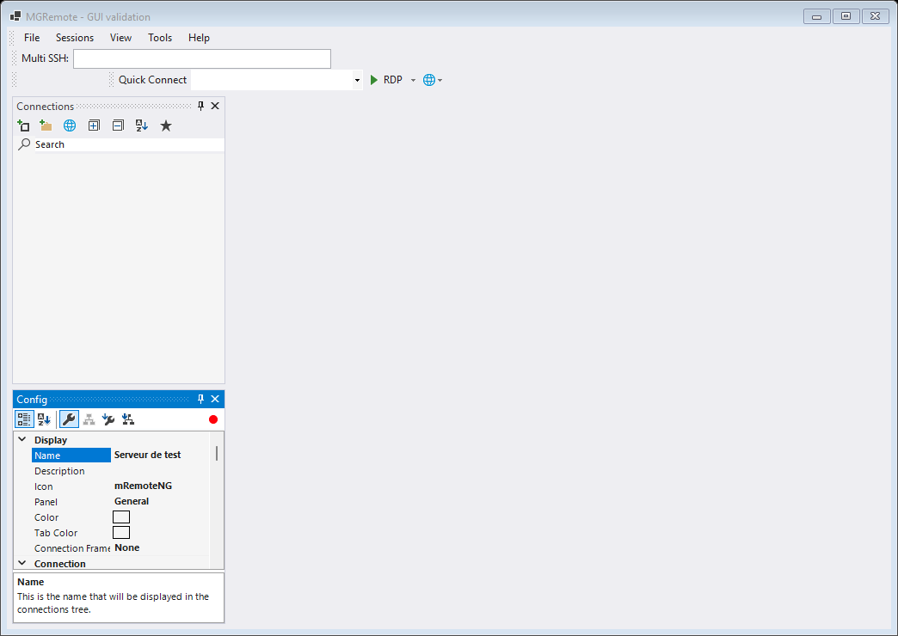

# MGRemote

MGRemote is an independent remote-connection manager derived from [mRemoteNG](https://github.com/mRemoteNG/mRemoteNG). It provides a Windows desktop edition. This project is not affiliated with or endorsed by the upstream mRemoteNG team.

## Downloads

| Platform | Current package | Status |
| --- | --- | --- |
| Windows x64 | [MSI 0.1.18](https://github.com/aurelson101/mgremote/releases/tag/windows-v0.1.18) | Unsigned preview |
| Windows ARM64 | [Native MSI 0.1.18](https://github.com/aurelson101/mgremote/releases/tag/windows-v0.1.18) | Unsigned preview |

Download the Windows MSI from the release. SHA-256 manifests, validation reports and the corresponding source archive accompany the installer.

## Interface



Actual Windows interface captured during GUI validation with synthetic data. No live remote session is shown.

## Windows edition

- Tabbed RDP, SSH and VNC connections, with a separate connection-properties panel.
- Tools → Serial console (COM): integrated ANSI terminal, configurable baud rate, 5–8 data bits, parity, 1/2 stop bits, flow control and optional DTR. Default: 9600 baud, 8N1, no flow control. Serial sessions use independent windows, not imported XML tree nodes.
- Integrated ANSI/VT SSH terminal using Windows OpenSSH, ConPTY and locally bundled xterm.js. Imported SSH2 connections use this terminal even if their saved backend still says PuTTYNG.
- Optional OpenSSH/PEM private keys, native interactive passphrase/password prompts, OpenSSH profiles and managed SSH bastion tunnels.
- SSH copy/paste with Ctrl+Shift+C / Ctrl+Shift+V or the context menu. Multiline paste requires confirmation; Ctrl+C remains an interrupt.
- Two-pane SFTP browser with local/remote navigation, multiple selection, recursive folders, a transfer queue, progress and cancellation. Drag files/folders between the panes in either direction, or from Windows Explorer onto the remote pane. Password authentication is available without a private key. Existing files are preserved unless replacement is explicitly enabled; links/junctions are not followed.
- RDP certificate policy: strict validation by default, or explicit native certificate confirmation with **Warn if authentication fails**. CredSSP/NLA stays enabled.
- Explicit RDP clipboard and selected-drive sharing controls, plus monitor and window-placement recovery. Sharing changes require reconnection; server policies may restrict them.
- mRemoteNG XML import, optional external AnyDesk integration and Windows MSI maintenance/upgrade support.

Install the MSI normally. Windows OpenSSH Client and the Microsoft Edge WebView2 Runtime are required for the integrated SSH terminal. PuTTY PPK keys must be converted to OpenSSH/PEM for OpenSSH use. Always verify the server fingerprint or certificate through a trusted channel.

Silent installation and removal use standard Windows Installer commands:

```powershell
msiexec /i "MGRemote-0.1.18-win-x64-preview.msi" /qn /norestart
msiexec /x "MGRemote-0.1.18-win-x64-preview.msi" /qn /norestart
```

Removal preserves user settings by default. `PURGEUSERDATA=1` explicitly requests cleanup of app-owned data for the current interactive user. It does not erase operating-system or antivirus records, other users' profiles, documents or personal SSH keys. See [Windows implementation notes](MGREMOTE-WINDOWS.md).

## RDP certificate warnings and recovery

Strict certificate validation remains the default. To review and explicitly accept a server certificate, select **Warn if authentication fails** in the connection's authentication settings. Verify the certificate before confirming; CredSSP/NLA stays enabled.

Automatic reconnect checks the configured endpoint in the background and updates ActiveX on the Windows UI thread. Closing the session stops its timer and invalidates pending results. Normal disconnections do not start an automatic reconnect loop. Pre-login errors include disconnect codes instead of silently closing the session.

## Concurrency and ARM64

SSH/ConPTY and serial sessions run input/output on background workers. Transfers await child processes asynchronously, and upload-tree validation runs off the UI thread. Input queues are bounded. The plain-text fallback console batches rendering every 33 ms and caps visible history at 200,000 characters. RDP ActiveX and Windows controls stay on the STA UI thread; reconnect probes run in the background with overlap prevention and close-time cancellation.

ConPTY pipe reads remain synchronous on a background worker per active terminal. The GUI test includes 16 simultaneous local ConPTY child processes, final-output checks, a GUI heartbeat and complete child cleanup. This is a bounded concurrency test, not a remote-server throughput guarantee.

Build scripts support `x64` and `arm64`. The Windows workflow uses separate native runners and requires the matching architecture before running GUI/ActiveX and MSI checks. See the release assets and architecture-specific manifests for ARM64 availability and native test coverage. Physical ARM hardware and live remote servers require a pilot.

```powershell
./Tools/Build-MGRemotePackage.ps1 -Platform arm64
```

## Security and validation status

These are unsigned development releases. Antivirus results describe a particular local scan, not a guarantee against all detections or SmartScreen warnings. No antivirus exclusions or certificate-validation bypasses are required or recommended.

Windows validation includes targeted security checks, synthetic XML/RDP imports, GUI lifecycle checks, actual offline RDP ActiveX certificate/redirection settings, reconnect UI dispatch and cancellation using a loopback TCP fixture, ConPTY terminal rendering and input, context-menu lifecycle, owned-process cleanup and MSI table/maintenance checks. Scan results apply only to the particular release containing them; this build has no Sophos validation.


Review covers maintained connection, import, persistence, terminal and lifecycle paths, plus compilation and dependency checks; it is not a claim that all upstream and third-party code is defect-free.

Physical USB/serial adapters and real switch consoles remain untested. Serial transport tests cover ANSI/split UTF-8, input delivery and cleanup. SSH1 and Telnet remain disabled by default; serial access does not weaken SSH host-key or RDP certificate checks.

Live RDP/SSH authentication, real remote file transfer, mixed-DPI/hot-plug monitors have not been validated on user infrastructure. A separate CI test installs, repairs and uninstalls the MSI on a disposable Windows runner without a previous MGRemote product, checks installed panel startup and preserves a synthetic user-data file. The runner includes development prerequisites and is not a pristine consumer OS. RDP through an SSH loopback tunnel may fail certificate-name checks; authentication is not weakened to hide that limitation. Live sessions require a pilot.

Do not open a public issue containing passwords, private keys or unredacted connection XML. Keep your clients and operating system patched, and verify all first-use host keys and certificates.

## Build

Windows: install .NET 10 and Visual Studio Build Tools with the .NET desktop workload, then run:

```powershell
./Tools/Build-MGRemotePackage.ps1
```

## Attribution and license

The Windows fork started from mRemoteNG commit `25ef453aaf18f292478dd41e5bb26798ff504312`. Copyright and contributor notices from mRemoteNG and bundled components are retained. MGRemote modifications are distributed under [GPL-2.0](COPYING.txt); third-party components retain their respective licenses. Release source archives provide the corresponding source for each published package.
